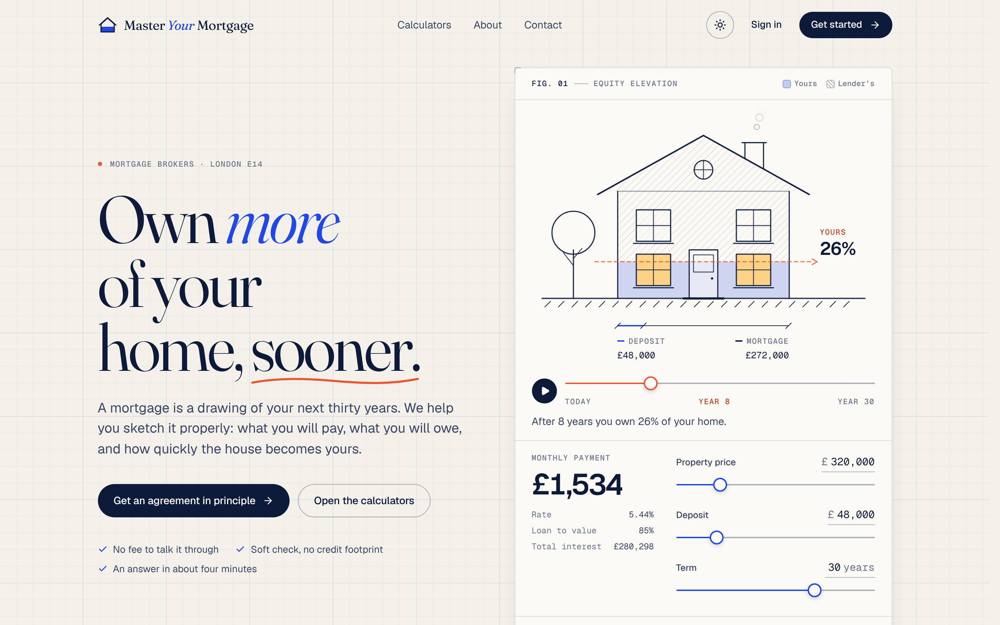
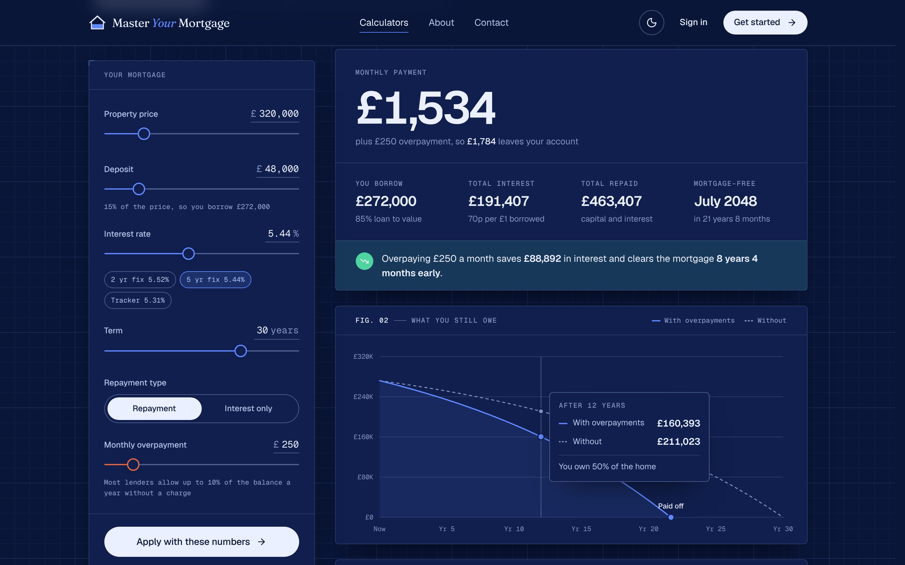

# Master Your Mortgage

A concept mortgage broker, built as a design and front-end engineering study. Live at [mortgage.elpis.cc](https://mortgage.elpis.cc).

The whole site is drawn like a set of architectural drawings: vellum paper in the light theme, a blueprint in the dark one. The centrepiece is a house elevation that fills with the share of the home you own as you move through the life of a mortgage.





> Master Your Mortgage is fictional. The arithmetic is real; the rates, the decisions and the company are not, and nothing here is financial advice.

## What is in it

- **Equity elevation.** Set a price, deposit and term, then drag or play the timeline. The shaded area of the house matches the share owned, and the windows light as the level passes them.
- **Repayment calculator.** Monthly payment, total interest, overpayments, interest-only, a rate stress table, a balance chart, a capital-versus-interest chart and a year-by-year schedule with CSV export. Inputs are mirrored in the address bar, so any result can be shared as a link.
- **Borrowing calculator.** A cautious, typical and stretch range from income and outgoings, with the working shown.
- **Stamp duty calculator.** Band-by-band Stamp Duty Land Tax for England and Northern Ireland (rates in force since 1 April 2025), for first-time buyers, movers and additional properties.
- **Agreement in principle.** A four-step form with validation and autosave that produces an on-screen decision and a printable certificate.
- **Dashboard.** Progress tracker, document checklist and the certificate, behind a sign-in.
- **Two themes**, a responsive layout down to phone width, keyboard-readable charts and reduced-motion support.

## No backend

There is no server and no third-party service. Accounts, applications, drafts and contact messages are stored in the visitor's own browser with `localStorage`. Passwords are kept only as a salted SHA-256 hash, which suits a demo and would not suit a real product. The sign-in page has a one-click demo account with a finished application.

## Stack

React 19, TypeScript, Vite, Tailwind CSS v4 and React Router. Charts and drawings are hand-written SVG; there is no chart or animation library. Fonts (Fraunces, Geist, Geist Mono) are self-hosted.

## Run it

```bash
npm install
```

```bash
npm run dev
```

Other scripts:

| Command | What it does |
| --- | --- |
| `npm run build` | Type-checks, then builds to `build/` |
| `npm run preview` | Serves the production build locally |
| `npm test` | Runs the unit tests for the finance maths |
| `npm run typecheck` | Type-checks without building |

## Layout

```
src/
  lib/          Pure logic: amortisation, stamp duty, affordability,
                application assessment, local storage, demo auth (with tests)
  hooks/        Spring animation, theme, URL sync, in-view, element width
  components/
    drawing/    House elevation, dimension line, location plan
    charts/     Balance chart, yearly bars, split bar, tooltip
    calculator/ The three calculators
    home/       Hero instrument, rates table, service glyphs
    layout/     Header, footer, page header, call to action
    ui/         Buttons, fields, sliders, segmented control, rolling number
  pages/        One file per route
  styles/       Design tokens and component styles
```

Brand and contact details live in `src/lib/site.ts`. The phone number is in Ofcom's range reserved for drama and the email uses the reserved `.example` domain, so neither reaches a real person.

## Deploying

`vercel.json` sets the framework to Vite, the output folder to `build` and a rewrite so that deep links such as `/calculator` load the app.
